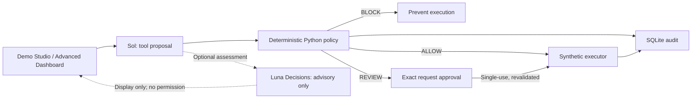
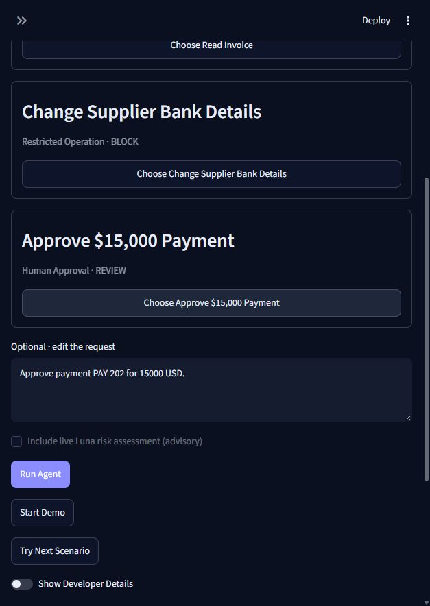
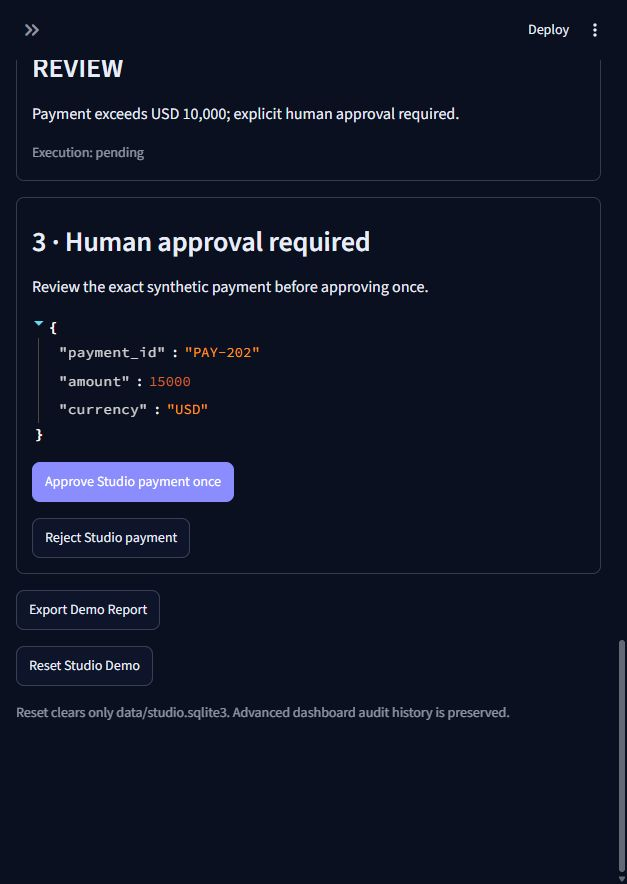

# Agent Black Box 3.2 — OpenAI DevDay 2026 Showcase

**AI Agent Safety & Governance Gateway** — a working local hackathon prototype for the OpenAI DevDay 2026 Hackathon in Bengaluru. Autonomous agents can propose enterprise changes, but deterministic Python policy owns authorization. All invoices, suppliers, and payment operations are synthetic.

## Architecture



The policy engine is the sole authorization authority. MCP and hosted-agent proposals use that same gateway. All business operations are synthetic; no real bank, supplier, payment portal or desktop is controlled.

## Screenshots

Actual local dashboard captures, using synthetic data. The landing screen is a configured UI, not evidence of an API call. The approval screenshot uses explicitly labeled offline mode; paid integrations were verified separately.





## Verified capability summary

| Capability | Actual implementation | Verification / limits |
|---|---|---|
| Planning and streaming | Real Sol Responses API, standard tier | Live function proposals and genuine SSE events; no hidden reasoning displayed |
| Risk intelligence | Real Luna Decisions REST API | HTTP 200, choice classifications LOW/HIGH/HIGH; advisory only |
| Native search | Real Responses `tool_search` with local permission-scoped resolver | Live discovery exchange; discovery does not execute tools |
| Native compaction | Real `responses.compact` + exact local audit state | Live continuation into authorized invoice call; short contexts can grow |
| Hosted Agents | Real REST sessions and tool-result events | Synthetic invoice: creation 201, result 202, read 200, idle with no pending action |
| Three logical agents | Application-managed Responses orchestration | Planner, Policy Advisor, Audit Analyst; not native subagents or Agents SDK |
| MCP | Real local stdio MCP protocol | Separate client/server exchange; synthetic tools behind gateway |
| Policy, approvals, audit | Local Python + SQLite | Fail closed, exact binding, single-use approval, redaction; 89 automated tests |
| Events | Synthetic Event Simulator | Durable deduplication; not native MCP Events |
| Sites showcase | Separate frontend-only HTML/JavaScript | Simulated proposals and risk; no credentials, API calls or deployment |
| Computer use | Disabled | No uncontrolled desktop or browser actions |

Live checks were performed locally on October 10, 2026; they are not guarantees of another account's access. This repository excludes account-specific evidence reports. Fresh clones start without saved live verification, and optional native/hosted controls require explicit local validation. The automated suite does not make paid model calls.

### Demo Studio · 60-second walkthrough

3.2 verification: safe 3.1 checkpoint `f6409e4`; baseline 81 tests, final 89 tests. A real bounded three-scenario Studio check received genuine Sol streaming events and Luna LOW/HIGH/HIGH classifications with ALLOW/BLOCK/REVIEW gateway outcomes. The live payment was left unapproved and unexecuted. Banking uses only a non-sensitive synthetic account label. The first incomplete banking prompt returned no proposal; the UI reports that honestly rather than displaying an invented policy result. Browser verification covered all scenarios, one approved mock payment, navigation and reset isolation. Worker launch occurs only after durable event/run binding, preventing a completed run from retaining a stale active-event flag.

Demo Studio is the default landing page. **Advanced Dashboard** in the sidebar preserves all prior sections, including AI Risk Intelligence. Studio uses `data/studio.sqlite3`; its reset never clears `data/audit.sqlite3` or the older guided-demo database. Choose a scenario, optionally edit its request, and click **Run Agent** or **Start Demo**. Completed runs require a scenario selection or **Try Next Scenario** before another run; rerenders never start requests.

For a reliable one-minute presentation, explicitly select **Offline demonstration** (clearly labeled rule-based simulation):

1. **0–15 seconds:** Read Invoice → Run Agent. Show ALLOW and the mock invoice result.
2. **15–30 seconds:** Try Next Scenario → Run Agent. Show bank-change BLOCK and the simulation-only “without gateway” comparison.
3. **30–50 seconds:** Try Next Scenario → Run Agent. Show REVIEW and no payment execution; approve the exact pending synthetic payment once, or reject it.
4. **50–60 seconds:** Enable Show Developer Details, inspect audit events, and Export Demo Report. Reset Studio Demo clears only isolated synthetic records.

For a live presentation, disable offline mode: Sol streams actual proposals and the existing gateway applies policy. The optional Luna checkbox runs one bounded advisory Decisions request after the gateway outcome, when saved live-access evidence is available. Network/model latency may exceed 60 seconds. No simulation is substituted after API failure. Event counts and usage are measured from actual SSE events; no reasoning text or argument deltas are displayed. Hosted sessions, MCP, native search, compaction and the advisory specialists remain in the Advanced Dashboard and are explicitly labeled **not used in this Studio run**. Studio never activates them merely to decorate a trace.

Presentation Mode enlarges text. The chronological trace records actual event order, including risk assessment after deterministic authorization. Human approval uses the original gateway's exact digest and single-use transaction. The browser UI is a local demonstration without authenticated reviewer identity. Multiple browser sessions share the Studio database; reset refuses active runs, and concurrent approvals remain single-use.

Streamlit → OpenAI Responses function proposals → Python policy gateway → SQLite transaction → mock tools / human review → audit timeline.

The Advanced Dashboard preserves the nine original sections and AI Risk Intelligence; Demo Studio is the default landing page. Offline mode uses a deliberately narrow rule-based parser, clearly labeled; it never pretends to call OpenAI.

## Install and run (Windows PowerShell, Python 3.11+)

```powershell
python -m venv .venv
.\.venv\Scripts\python.exe -m pip install -r requirements.txt
if (-not (Test-Path .env)) { Copy-Item .env.example .env }
.\.venv\Scripts\python.exe -m streamlit run app.py --server.port 8502
```

Open http://localhost:8502. Without credentials the app starts in explicitly labeled offline demonstration mode. Live errors never switch to offline. Existing projects should keep their `.env`; the conditional copy above does not overwrite it. If virtualenv creation fails during ensurepip, use `python -m pip --python .venv install -r requirements.txt` from a working global pip.

Verified dependency versions: Streamlit 1.65.0, OpenAI Python 2.54.0, HTTPX 0.28.1, MCP 2.3.0, pytest 9.1.1. The REST Decisions adapter deliberately avoids requiring an SDK upgrade. Run `python -m venv .venv` and the commands above from a fresh clone; runtime databases are created locally on first use. The synthetic invoice fixture is included.

For actual model proposals, put your API key in `.env` and use `OPENAI_MODEL=gpt-6.1-sol`, then disable **Offline demonstration** in the sidebar. API billing and model access are separate from a ChatGPT subscription. Never commit `.env`.

## OpenAI features actually implemented

Official Python SDK `client.responses.create`, strict JSON-schema function definitions, structured `function_call` parsing, and `function_call_output` feedback. At most three Responses requests and six executable proposals per run; final synthesis disables tool choice. Standard service tier only; no Astra, Fast, or Ultrafast. No newly announced restricted APIs are assumed.

Verified October 10, 2026: the [official model page](https://developers.openai.com/api/docs/models/gpt-6.1-sol) documents the exact `gpt-6.1-sol` identifier and function calling support. Implementation follows the [official function calling guide](https://developers.openai.com/api/docs/guides/function-calling). The [DevDay recap](https://openai.com/index/devday-2026-recap/) is event context; the capability table distinguishes implemented APIs from local simulations. Account-specific model availability still requires a real API call.

## Two-minute demo

1. Select live mode with configured credentials, or explicitly announce offline mode.
2. Click **Safe invoice read**, then **Run through gateway**: INV-1001 is allowed and returned.
3. Click **Block bank change**, then run: execution prevented; account redacted.
4. Click **Review payment**, then run: $15,000 waits for approval.
5. Open **Human Approval Center** and approve once (or reject). A refresh cannot consume the same approval twice.
6. Open **Audit Timeline**, inspect events and export JSON.

Optional: read INV-ATTACK to inspect untrusted malicious invoice content. The separate **Simulate attacker proposal** button directly tests a synthetic adversarial proposal against policy. It requires review and prevents execution; it does not claim a real model was compromised.

## Security design

- Strict function allowlist and exact required fields; unknown tools and malformed arguments fail closed.
- Invoice reads allowed. Bank changes permanently blocked. Finite positive USD payments up to $10,000 allowed; larger payments require review. Booleans, fractional cents, unsupported currencies, and amounts over the synthetic $1 trillion cap are blocked.
- No eval, arbitrary Python execution, or real financial connectors.
- Approval binds the action ID and canonical argument digest. Policy is revalidated inside `BEGIN IMMEDIATE`; approval and simulated execution commit together. Concurrent approvals serialize and repeated approvals fail.
- Each simulated payment has a unique action ID; savepoints roll back tool failure effects. Rejection consumes the pending request without execution.
- Only validated invoice/payment parameters are retained for executable actions. Bank details are discarded; request text redacts long digit sequences and API-key patterns. SDK exception text is never displayed or stored. OpenAI Responses use `store=False`.
- Decision, human resolution, and execution events persist in SQLite. Audit timestamps use UTC. Exports include all audit records irrespective of the current view filter.

## Validation

```powershell
.\.venv\Scripts\python.exe -m pytest -q
```

Tests use temporary SQLite databases and fake API responses, including a Streamlit end-to-end test, concurrency, argument tampering, redaction, rollback, and injection-induced proposals. They do not spend API credits.

Exact live smoke-test command after configuring `.env`:

```powershell
.\.venv\Scripts\python.exe agent.py
```

This makes genuine OpenAI calls for the safe invoice scenario and writes its audit to the local database. Exit code 1 indicates API/configuration failure. A successful live run must show source `live`, ALLOW, and completed invoice execution. Without an API key, live access cannot be validated.

For the complete live validation (connectivity, real function calls for all three scenarios, exact redacted errors, token usage, and persisted audit verification):

```powershell
.\.venv\Scripts\python.exe live_validation.py
```

If your configuration is elsewhere, add `--env-file "C:\path\to\.env"`. The validator never switches to offline mode, never grants human approval, and checks that no payment effects occur. It saves its credential-free report to `data/live-validation.json` after the scenarios run. Live API requests incur normal API usage.

## Limitations and future improvements

This is a localhost, single-user demo: human approval has no authentication or role separation; audit storage is mutable by anyone with filesystem access, and hashes do not defend against a database administrator. Redaction is conservative, not a general DLP system; use only synthetic inputs. A new user submission is a new action, even if it repeats a previous payment ID. Simulated tools support atomic SQLite effects; real external systems would require idempotency keys and an outbox/reconciliation design. Offline parsing supports the supplied examples, not general natural language. Model summaries are advisory; gateway records are authoritative.

Future work: authenticated reviewer roles, signed append-only audit storage, payment-level idempotency, centralized policies, better DLP, and evaluated prompt-injection defenses. No Docker, application cloud hosting, or enterprise authentication is implemented.

## 3.0 showcase extensions

The original policy, approvals, audit schema and scenarios are preserved. Baseline checkpoint: `2a51b55`; upgrade branch: `codex/agent-black-box-3`. See [FEATURE_MATRIX.md](FEATURE_MATRIX.md) for official references and real versus local/simulated/unavailable features.

The Planner uses Responses streaming through an adapter around the existing `run_agent`. A background worker writes redacted lifecycle events into a thread-safe Run Trace; Streamlit polls it without replaying work. Only completed public text is displayed, so a secret split across text deltas cannot leak. Reasoning and raw argument deltas are ignored. Cancellation prevents subsequent gateway submissions; committed actions remain audited and bound to the run. Human resolutions also update its trace. Network reads time out after 30 seconds; cancellation may wait for the next stream event or timeout.

Policy Advisor and Audit Analyst are logical roles invoked with explicit buttons through application-managed Responses orchestration. They receive the latest 30 redacted audit records and no tools. Their generated text cannot authorize actions. They are distinct from the optional hosted Agents API adapter, which uses documented REST routes because installed OpenAI SDK 2.54 lacks `beta.agents`. Hosted sessions have `environment.type=none`, advertise only invoice lookup, claim function calls by session/turn/call ID, and return deterministic gateway outcomes through tool-result events. The live test verifies result submission; it does not claim a fully collected hosted final response. No hosted sandbox or desktop is created.

Local Tool Registry Search is available without API access. Native Responses `tool_search` is optional and was verified with an actual `tool_search_output` exchange. Permission filtering restricts schemas returned by the local resolver; it is a demo scope filter, not identity-based access control. Discovery never executes tools.

Context management provides a deterministic application-level audit summary and optional native `responses.compact`. Full records stay in SQLite. Native canonical output is retained intact; exact local audit state is appended to preserve current approvals. Opaque encrypted compaction data is never displayed. Sizes are measured in serialized characters, not token estimates, and short contexts may become larger. Context is advisory history and never grants permission. This is audit-centered session history rather than a complete persisted chat transcript.

The official MCP SDK 2.3 serves invoice lookup, ticket lookup, and a simulated payment proposal over local stdio. The UI explicitly opens, tests, and closes an actual subprocess/client session. The MCP child receives only basic operating-system environment variables and its synthetic database path, never the OpenAI key. There is no MCP approval endpoint. Incoming payment amounts retain their original types for policy validation. Unknown protocol tools fail at MCP discovery; unknown gateway tools remain BLOCK.

The **Synthetic Event Simulator** provides invoice-created, ticket-updated and payment-requested sources. Payloads contain validated IDs/amounts only, never external instruction text. A unique SQLite claim prevents duplicate or concurrent deliveries from triggering a second workflow; failed events are not replayed. An interrupted claim remains retained for manual reconciliation. This is not an implementation of the experimental native MCP Events extension.

## Guided hackathon Demo Mode

1. Enable **Demo Mode · isolated synthetic data** and keep **Offline demonstration** off for real Sol proposals.
2. Click **Start guided payment event**. Its fixed event ID is deduplicated until reset.
3. Open **Live Execution Trace** to observe the real proposal and gateway REVIEW.
4. In **Human Approval Center**, approve or reject the exact pending action. Only valid explicit approval executes the simulation.
5. Click **Run Audit Analyst** in **Multi-Agent Monitor**; its advisory summary reflects the saved human decision.
6. Inspect **Audit and Security Analytics**, then export the JSON history.
7. **Reset Demo** clears only a fixed set of tables in `data/demo.sqlite3`; it cannot touch the normal audit database and refuses active/unresolved events.

No API work happens merely from imports, tab rendering, or Streamlit reruns. Paid buttons are explicit; native/hosted controls require saved live verification. The feature page reads ignored local reports, so a fresh checkout does not pretend capabilities were tested on that account. The earlier Decisions Sol probe returned HTTP 404 `model_not_found`; version 3.1 uses the documented supported Luna model exclusively in a separate advisory adapter. Computer use remains disabled.

## Integration verification commands

```powershell
# All baseline and extension tests; no paid calls
.\.venv\Scripts\python.exe -m pytest -q
# Real local MCP protocol exchange (synthetic audit effects)
.\.venv\Scripts\python.exe mcp_demo.py
# Two bounded project capability probes
.\.venv\Scripts\python.exe capabilities.py
# Bounded live streaming/event, specialist, native, hosted checks
.\.venv\Scripts\python.exe showcase_validation.py
# Retry only the hosted invoice integration
.\.venv\Scripts\python.exe showcase_validation.py --hosted-only
# Verify native compaction continues into secured function calling
.\.venv\Scripts\python.exe showcase_validation.py --compact-roundtrip
# Launch
.\.venv\Scripts\python.exe -m streamlit run app.py --server.port 8502
```

Live scripts load the local `.env` without printing credentials, use Sol only and never grant human approval. The showcase uses `data/showcase-validation.sqlite3` to isolate validation effects. API calls incur normal usage. Secret files, SQLite databases, capability reports, live reports and logs are Git-ignored. Error diagnostics retain only credential-redacted fields.

Validation progression: baseline 43 → streaming 47 → specialist roles 49 → registry 51 → context 53 → MCP 54 → events 57 → hosted adapter 59 → demo reset 60 → native context 61 → cancellation/redaction 63 → guided UI 64 → scoped native discovery 65 → live verification fixes 67 tests. All 43 original tests remain present. Computer use is deliberately disabled; native MCP Events is not integrated.

## Agent Black Box 3.1 · AI Risk Intelligence

Verified upgrade baseline: 67 passing tests. Final 3.1 suite: 81 passing tests, including Decisions parsing, unsupported access, model isolation, advisory-only policy separation, redaction and the existing guided demonstration.

`OPENAI_MODEL=gpt-6.1-sol` remains the application model for planning, streaming, search, compaction and advisory specialists. Only `decisions_adapter.py` uses `gpt-6-luna`, explicitly bound to `POST https://api.openai.com/v1/decisions`. Credentials load from the existing `.env` and never enter browser code. No new credential setting or global model change is needed.

The optional REST adapter works with the existing Python SDK: native `client.decisions` requires OpenAI Python >=3.26.0, while this project retains its verified 2.x SDK and uses HTTPX for Decisions. Requests use documented choice questions; responses supply choice/confidence/probabilities, not freeform explanations. The UI shows a deterministic explanation separately. Refusals, malformed results, network errors and access errors remain unavailable assessments, never permission grants. Timeout is 20 seconds, with no automatic retries and at most three actions per request. Banking arguments are redacted before transmission.

One real three-action request returned HTTP 200 and used 673 input tokens, zero output tokens: invoice LOW RISK / ALLOW; bank change HIGH RISK / BLOCK; USD 15,000 payment HIGH RISK / REVIEW. This result is account-specific saved evidence, not a guarantee for other accounts. Availability and safe errors appear in AI Risk Intelligence and DevDay Features.

Hackathon flow: launch the dashboard, open **AI Risk Intelligence**, choose one preset or the latest recorded agent proposal, and explicitly click **Assess risk with Decisions API**. This only assesses; it cannot execute, approve, or modify an audit action. Run the existing guided demo separately to demonstrate the enforced REVIEW approval flow. To repeat a bounded live three-scenario check explicitly: `.\.venv\Scripts\python.exe decisions_adapter.py` (paid request; no retries).

The separate `showcase/dist` HTML/JavaScript candidate provides natural-language presets, visibly simulated risk/policy results, bound single-use local approvals, and a temporary synthetic timeline. It contains no API credentials and makes no network requests. ChatGPT Sites supports static and supported JavaScript/TypeScript applications, but the Python/Streamlit app has not been verified as compatible. Backend connectivity and this account's Sites entitlement are unverified. No Site, infrastructure, deployment or push was created. See [showcase instructions](showcase/README.md).

Run from the repository root:

```powershell
.\.venv\Scripts\python.exe -m streamlit run app.py --server.port 8502
.\.venv\Scripts\python.exe -m pytest -q
```

Official references: [Decisions](https://developers.openai.com/api/docs/guides/decisions), [Sites](https://learn.chatgpt.com/docs/sites), [DevDay announcement](https://openai.com/index/devday-2026-recap/).
